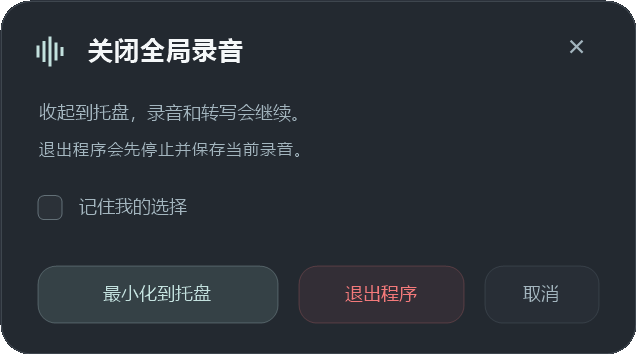

# 全局录音 · GlobalRecorder

面向 Windows 的轻量桌面录音工具。C++17 / Win32 / WASAPI / GDI+ 主程序，支持麦克风与电脑声音同步录制，可选本地离线转写。


## 功能

- 同时保留麦克风、电脑声音和混音三条完整音轨。
- 选择全局声音，或只采集指定程序及其进程树的声音。
- 透明悬浮条、四边半圆贴边收起、托盘操作；不显示任务栏按钮。
- 自定义录音与暂停转写快捷键、录音目录、开机自启动。
- 关闭时选择退出或收起到托盘，可记住选择。
- 可选 faster-whisper 本地转写；关闭或暂停转写不影响录音。
- 可选麦克风活动触发：检测后询问或自动开始录音，默认关闭。

活动触发依赖本机音频会话元数据。语音消息和语音输入也可能触发，并不是精确的微信通话检测；结束时需要手动停止录音。



## 运行与构建

主程序不需要 Python、Qt、Electron 或 WebView。请将程序放在可写目录。

构建使用 **Zig 0.15.2** 的 Windows x86_64 版。将 `zig.exe` 加入 PATH，或传入完整路径：

```powershell
.\native\build.ps1 -ZigPath 'E:\Tools\zig\zig.exe'
.\native-bin\GlobalRecorder.exe
```

保留 `native-bin/GlobalRecorder.exe` 与 `native/native_transcribe.py` 的相对目录关系。程序数据根目录为 `native-bin` 的父目录，设置、队列与默认 `recordings/` 均放在该根目录。

全局回环录音面向 Windows 10/11。按程序采集要求 Windows build 20348 或更高；不支持、目标未启动或初始化失败时会报错，不会自动退回全局采集。

## 使用

左侧圆钮或 `Ctrl+Alt+R` 开始/停止录音。“转写”开关控制本地识别，暂停按钮或 `Ctrl+Alt+T` 暂停/恢复识别。

通过 `…` 菜单设置保存目录、监听程序、快捷键和自启动。录音开始后，本次会话的目录与目标进程固定，设置修改从下一次录音生效。

拖动空白区域靠近屏幕边缘并松手后收起为半圆；悬停展开，移开约 650 ms 后收回。收起动画 420 ms、展开 340 ms，遵循系统客户端动画设置。

每次会话保存为独立文件夹，完整音轨为 16 kHz 单声道 PCM16 WAV：

```text
recordings/
  轻量_时间_唯一编号/
    microphone.wav
    system.wav
    mix.wav
    转写.txt          # 开启识别后生成
    chunks/           # 待处理分段与任务
```

三条完整音轨合计约 5.8 MB/分钟，另有待转写分段。

## 可选离线转写

录音本身不依赖转写组件。需要转写时，使用 Python 3.11+ 环境安装 `requirements-asr.txt`，自行准备完整的 faster-whisper 模型目录：

```powershell
py -3.11 -m venv .venv-asr
.\.venv-asr\Scripts\python.exe -m pip install -r requirements-asr.txt
```

默认查找 `.venv-asr/Scripts/pythonw.exe` 和 `models/faster-whisper-small/`。也可以在退出程序后编辑程序根目录的 `native.ini`，在已有 `[recorder]` 节中加入：

```ini
asr_python=E:\ASR\Scripts\pythonw.exe
asr_model=E:\Models\faster-whisper-small
```

相对路径以程序数据根目录解析。INI 由程序以 UTF-16 写入，编辑时请保留编码。示例见 `native.ini.example`；不要用示例覆盖自己的已有设置。

识别强制离线、CPU int8、4 线程。模型与 Python 依赖需要自行准备，不随源码分发；主程序不会自动下载模型或上传音频。暂停/关闭时会处理完当前分段后释放模型，未完成音频保留在本地队列中。

## 验证

以下检查不采集音频、不启动模型、不注册真实全局快捷键：

```powershell
.\native-bin\GlobalRecorder.exe --self-test .\work\checks
.\native-bin\GlobalRecorder.exe --config-test .\work\checks
.\native-bin\GlobalRecorder.exe --window-test .\work\checks
.\native-bin\GlobalRecorder.exe --dock-test .\work\checks
py -3 -B -m unittest discover -s native -p test_native_transcribe.py -v
```

验证范围和已知限制见 [验证说明](docs/validation.md)。真实设备、程序声音隔离和真实微信通话验收不包含在合成检查中。

## 许可与来源

采用 [MIT License](LICENSE)。项目起源于 Lukas Mayr 的 [QuickAudioRecorder](https://github.com/lukmay/QuickAudioRecorder)，保留上游版权许可；此仓库整理发布后续的原生 C++ 实现。来源和依赖说明见 [NOTICE](NOTICE.md)。
